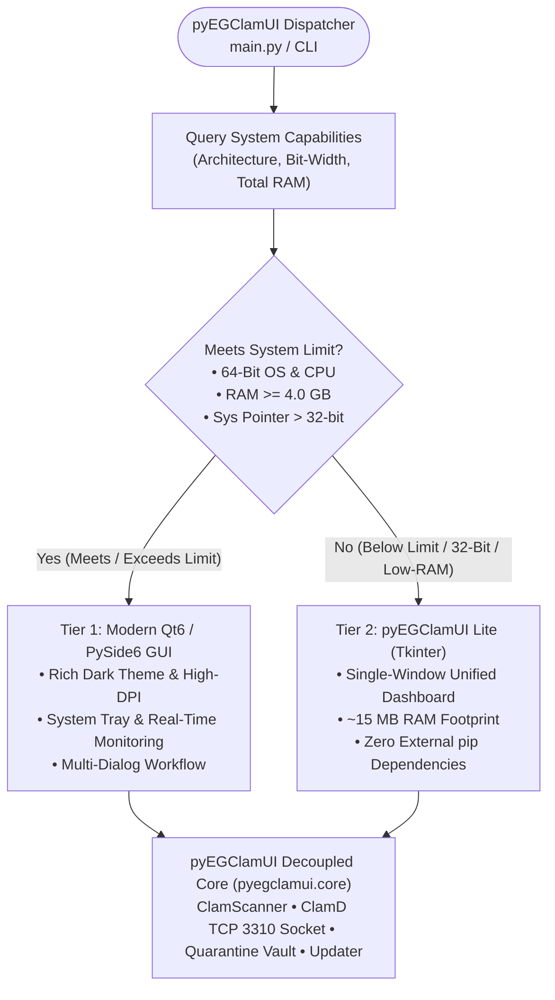
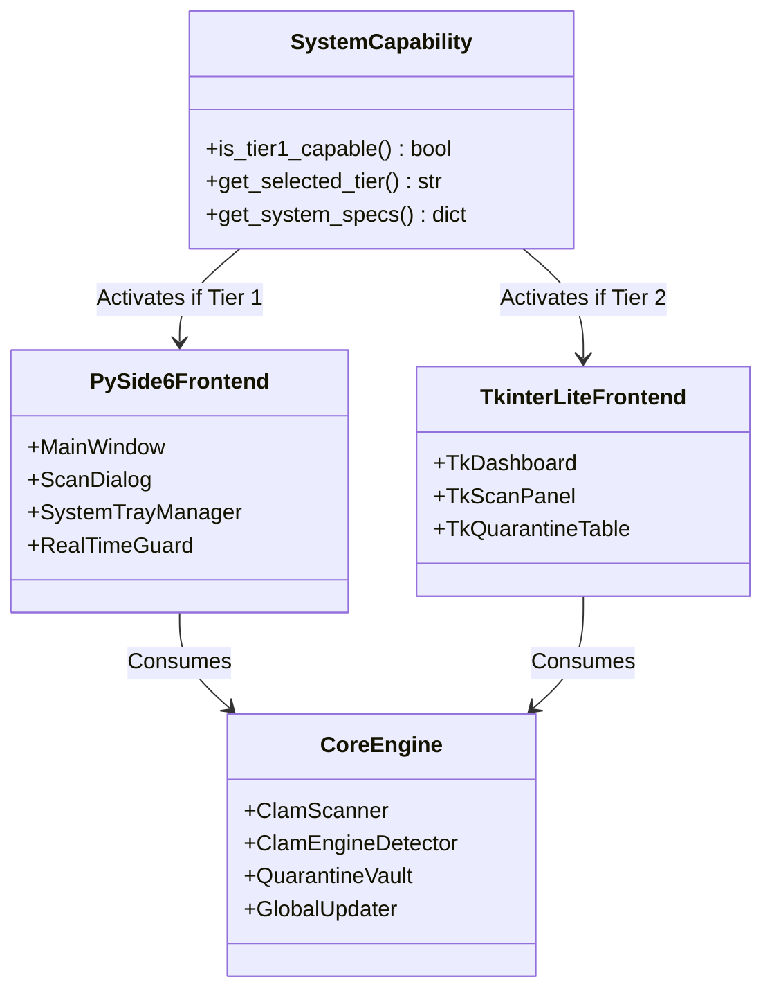

# Deterministic Adaptive GUI Architecture: PySide6 & Tkinter Dual-Tier Specification

This document defines the architectural specification and implementation design for the **Deterministic Dual-Tier GUI Engine** in **pyEGClamUI**. 

Rather than relying on runtime import trial-and-error (`try: import PySide6`), the application evaluates a **deterministic hardware and system capability threshold**. Systems meeting or exceeding the specification boundary run the full-featured **Qt6 / PySide6 Desktop GUI**, while systems below the threshold automatically run the ultra-lightweight **Tkinter Lite Interface**.

---

## 1. System Architecture Limit & Qualification Matrix

The dispatching decision is strictly governed by objective system properties: CPU word size, pointer address space, physical memory capacity, and OS version.



### Deterministic Threshold Specifications

| Metric / Parameter | 🛡️ High-Spec Tier 1 Threshold (Qt6) | ⚡ Low-Spec Tier 2 Threshold (Tkinter) | Evaluation Method |
| :--- | :--- | :--- | :--- |
| **CPU Architecture** | 🟢 `x86_64`, `amd64`, `arm64`, `aarch64` | 🟡 `i386`, `i686`, `x86`, `armv7l`, `armv6l` | `platform.machine().lower()` |
| **Pointer Bit-Width** | 🟢 64-Bit (`sys.maxsize > 2**32`) | 🟡 32-Bit (`sys.maxsize <= 2**32`) | Standard Python `sys.maxsize` |
| **Physical System RAM**| 🟢 **>= 4096 MB (4.0 GB)** | 🟡 **< 4096 MB (< 4.0 GB)** | `psutil.virtual_memory().total` |
| **Operating System** | 🟢 Windows 10/11, macOS 12+, Linux 64-bit | 🟡 Linux 32-bit (antiX, Debian i386), Win32 | `sys.platform` |
| **GUI Framework** | 🟢 **PySide6 (Qt 6)** | 🟢 **Tkinter (`tkinter.ttk`)** | Deterministic selector |
| **Idle RAM Footprint** | ~65 MB – 90 MB | **~12 MB – 18 MB** | Runtime measurement |
| **External pip pkgs** | PySide6, clamd, psutil, watchdog, send2trash | clamd, psutil, send2trash (Tkinter built-in) | Package manifests |

> [!NOTE]
> **Why 4.0 GB RAM Is the Primary Boundary**:
> The ClamAV virus signature database contains over 8.5 million signatures and requires **~1.2 GB to 1.5 GB of RAM** when loaded into memory. Combined with the underlying operating system and background desktop processes, machines with 4 GB or less RAM experience severe memory pressure and disk thrashing under a full Qt6 runtime. Setting the boundary at **4.0 GB** ensures machines with <= 4 GB RAM run the ultra-lightweight Tkinter Lite (~15 MB), leaving ample physical memory for the antivirus engine.

---

## 2. Component Design & Frontend Specifications

### 2.1 Tier 1: Modern Qt6 / PySide6 Suite (High-Spec)

Tier 1 serves standard 64-bit desktop environments on Windows, macOS, and Linux:

* **Visual Experience**: Centralized modern dark theme (`DARK_THEME_QSS`), high-DPI font scaling, smooth transitions, and custom SVG status indicators.
* **System Tray & Lifecycle**: Full close-to-tray minification, dynamic tooltip reporting scan status, and native OS desktop notification balloons.
* **Real-Time Guard**: Background thread monitoring watched directories via `watchdog` and alerting on newly downloaded files.
* **Comprehensive Dialog Suite**: Dedicated multi-window dialogs for Scans, Issue Reporting, Quarantine Vault, and Settings.

### 2.2 Tier 2: pyEGClamUI Lite / Tkinter Suite (Low-Spec / 32-Bit)

Tier 2 serves vintage hardware, low-memory virtual machines (e.g., 32-bit antiX in VirtualBox), and embedded Linux environments:

* **Single-Window Unified Dashboard**: A streamlined, all-in-one window containing the essential controls without child popup dialogs.
* **System Health Banner**: Live badges displaying ClamAV engine version, signature count, and daemon connection status (TCP 3310 vs CLI).
* **Direct Action Toolbar**:
  * 🟢 **Quick Scan**: Scans current user profile and download locations.
  * 🔍 **Full Scan**: Scans all mounted volumes.
  * 📂 **Custom Scan**: Native file and directory chooser.
  * 🔄 **Update Definitions**: Runs `freshclam` with animated progress status.
  * 📦 **Quarantine Vault**: Embedded table listing quarantined items with **Restore** and **Delete** actions.
* **Embedded Log & Progress Panel**: Real-time console displaying scanned file paths and threat alerts.
* **Zero Additional pip Dependencies**: Built entirely on standard Python `tkinter` and `tkinter.ttk`.

---

## 3. Decoupled Core Integration Model

Both GUI frontends are pure presentation layers that consume the identical business logic modules in [`../src/pyegclamui/core/`](../src/pyegclamui/core/):



### Shared Core Interfaces

| Core Module | Shared Functionality | Consumed By Both Frontends |
| :--- | :--- | :---: |
| [`scanner.py`](../src/pyegclamui/core/scanner.py) | `ClamScanner`, scan callbacks, threat parsing, cancellation | 🟢 Identical |
| [`detector.py`](../src/pyegclamui/core/detector.py) | Engine binary discovery (`clamscan`), daemon port check (`clamd`) | 🟢 Identical |
| [`quarantine.py`](../src/pyegclamui/core/quarantine.py) | Isolating threats, safe restore, permanent deletion, SHA-256 | 🟢 Identical |
| [`updater.py`](../src/pyegclamui/core/updater.py) | `freshclam` invocation, signature parsing, database updates | 🟢 Identical |
| [`config.py`](../src/pyegclamui/core/config.py) | JSON settings load/save, custom paths, directory exclusions | 🟢 Identical |

---

## 4. System Qualification Engine (`system_capability.py`)

A dedicated module in `src/pyegclamui/core/system_capability.py` deterministically decides which frontend to launch without trial-and-error imports:

```python
"""
Deterministic System Capability Inspector.
Evaluates hardware specifications against architectural thresholds.
"""

import os
import platform
import sys
from typing import Literal

GuiTier = Literal["pyside6", "tkinter"]

# Architecture limits
MIN_RAM_BYTES_TIER1 = 4 * 1024 * 1024 * 1024  # 4.0 GB
LEGACY_ARCHS = {"i386", "i686", "i486", "i586", "x86", "armv7l", "armv6l"}


def get_total_ram_bytes() -> int:
    """Returns total system memory in bytes using standard library or psutil."""
    try:
        import psutil
        return int(psutil.virtual_memory().total)
    except Exception:
        pass

    # Linux fallback via /proc/meminfo
    if sys.platform.startswith("linux") and os.path.isfile("/proc/meminfo"):
        try:
            with open("/proc/meminfo", "r", encoding="utf-8") as f:
                for line in f:
                    if line.startswith("MemTotal:"):
                        kb = int(line.split()[1])
                        return kb * 1024
        except Exception:
            pass

    # Fallback to generous assumption if undetectable
    return 8 * 1024 * 1024 * 1024


def determine_gui_tier(user_override: str | None = None) -> GuiTier:
    """
    Deterministically evaluates system capabilities to pick the appropriate GUI tier.
    Does NOT rely on PySide6 import trial-and-error.
    """
    if user_override in ("pyside6", "qt6", "qt"):
        return "pyside6"
    if user_override in ("tkinter", "tk", "lite"):
        return "tkinter"

    arch = platform.machine().lower()
    is_64bit = sys.maxsize > 2**32 and arch not in LEGACY_ARCHS
    total_ram = get_total_ram_bytes()

    # Boundary check: must be 64-bit CPU/OS and have at least 4.0 GB RAM
    if is_64bit and total_ram >= MIN_RAM_BYTES_TIER1:
        return "pyside6"

    return "tkinter"
```

---

## 5. Setup & Packaging Alignment

### 5.1 Python Dependency Alignment (`requirements.txt` & `pyproject.toml`)
* **64-Bit Platforms**: Installs full production stack (`PySide6>=6.2.0`, `clamd`, `psutil`, `watchdog`, `send2trash`).
* **32-Bit / Low-Spec Platforms**: Installs core stack (`clamd`, `psutil`, `watchdog`, `send2trash`) via existing PEP 508 markers:
  ```text
  PySide6>=6.2.0; platform_machine != 'i686' and platform_machine != 'i386' and platform_machine != 'x86' and platform_machine != 'armv7l'
  ```
* **System Tkinter Verification**:
  * On Linux (Debian/antiX/Ubuntu): Setup verifies `python3-tk` is installed (`sudo apt-get install -y python3-tk`).
  * On Windows & macOS: Tkinter is bundled with official Python distributions by default.

### 5.2 Command-Line Interface (`main.py`)
Users can optionally force a specific GUI tier if desired:
```bash
pyegclamui             # Auto-select based on deterministic hardware limits
pyegclamui --ui=qt     # Force Tier 1 PySide6 GUI (if 64-bit)
pyegclamui --ui=tk     # Force Tier 2 Tkinter Lite GUI (low RAM mode)
```

---

## 6. Phased Implementation Roadmap & Status

| Phase | Milestone | Deliverables | Status |
| :---: | :--- | :--- | :---: |
| **Phase 1** | **Capability Engine** | Implement [`system_capability.py`](../src/pyegclamui/core/system_capability.py) and boundary tests | 🟢 Completed |
| **Phase 2** | **Tkinter Lite Interface** | Create [`tk_app.py`](../src/pyegclamui/gui/tk_app.py) dashboard connecting to decoupled core | 🟢 Completed |
| **Phase 3** | **Dispatcher Integration** | Update [`app.py`](../src/pyegclamui/gui/app.py) to route using the capability engine & fallback | 🟢 Completed |
| **Phase 4** | **Setup Suite Sync** | `python3-tk` checks in [`setup/setup.py`](../setup/setup.py), [`install.sh`](../setup/install.sh), and CI | 🟢 Completed |
| **Phase 5** | **Test Verification** | Automated test matrix across unit suites ([`tests/`](../tests/)) | 🟢 Completed |

---

## 7. Architectural Conclusion

This deterministic design guarantees:
1. **Zero Guesswork**: The system never attempts to load PySide6 on hardware incapable of supporting it.
2. **True Universality**: pyEGClamUI delivers a native desktop window on every machine, from high-end multi-core 64-bit workstations down to 32-bit antiX VirtualBox environments with under 1 GB RAM.
3. **Core Preservation**: Existing business logic and the modern Qt6 interface remain 100% clean and uncompromised.
