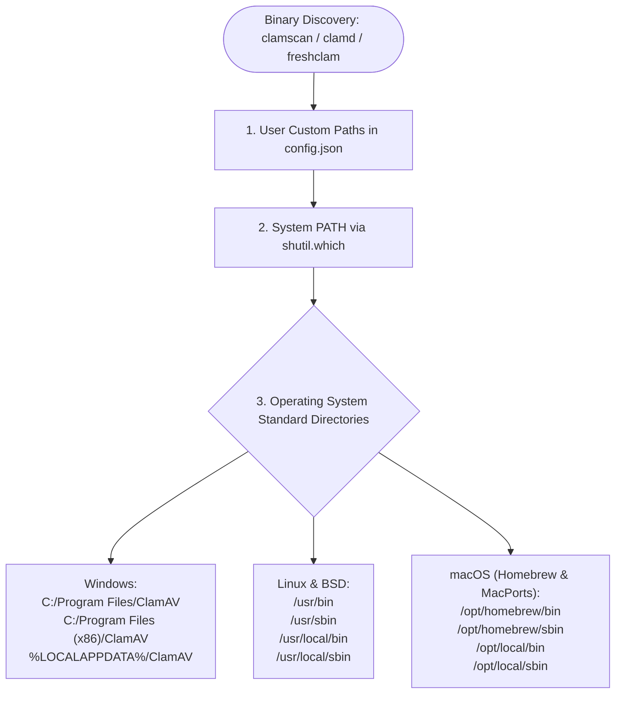
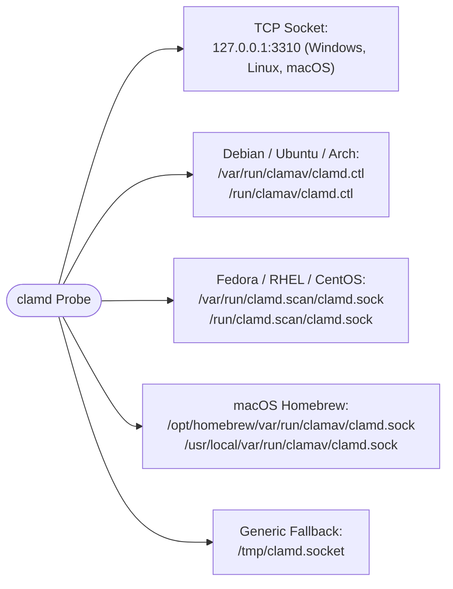

# Cross-Platform Hardening & Operating System Matrix

**pyEGClamUI** is designed from the ground up to operate natively and reliably across **Windows**, **Linux**, and **macOS**.

---

## 1. Operating System Capabilities Matrix

| Feature | Windows (10 / 11) | Linux (Ubuntu, Fedora, Arch) | macOS (12+ Monterey to Sonoma) |
| :--- | :--- | :--- | :--- |
| **Primary Execution Backend** | `clamscan.exe` CLI process | `clamd` Unix socket or `clamscan` | `clamd` Unix socket or `clamscan` |
| **Daemon Socket Communication** | TCP (`127.0.0.1:3310`) | Unix socket (`/var/run/clamav/clamd.ctl`) | Unix socket (`/opt/homebrew/var/run/...`) |
| **Native System Startup** | Registry (`HKCU\...\Run`) | XDG Autostart (`~/.config/autostart`) | Launchd Agent (`~/Library/LaunchAgents`) |
| **System Tray / Menu Bar** | Windows Taskbar Notification Area | FreeDesktop System Tray / AppIndicator | macOS Top Menu Bar Status Item |
| **Desktop Application Menu** | Start Menu Shortcuts | XDG Desktop Entry (`/usr/share/applications`) | macOS Dock & Application Bundle |
| **Automated Engine Installer** | Winget + Cisco MSI silent installer | Tailored package manager instructions (`apt`/`dnf`) | Homebrew (`brew install clamav`) |
| **Safe Threat Trash / Recycling** | Windows Recycle Bin (`send2trash`) | FreeDesktop Trash (`~/.local/share/Trash`) | macOS Trash (`~/.Trash`) |
| **Window Frame Behavior** | Native Windows Aero Snap | Native Wayland / X11 Tiling & Floating | macOS Native Split View & Cocoa Frames |

---

## 2. Cross-Platform Directory & Path Mapping

* **Source File**: [`../src/pyegclamui/core/config.py`](../src/pyegclamui/core/config.py) (`AppPaths`)

| Directory Purpose | Windows Location | Linux Location | macOS Location |
| :--- | :--- | :--- | :--- |
| **User Configuration** | `%APPDATA%\pyEGClamUI` | `~/.config/pyegclamui` | `~/Library/Application Support/pyEGClamUI` |
| **Application Data** | `%LOCALAPPDATA%\pyEGClamUI` | `~/.local/share/pyegclamui` | `~/Library/Application Support/pyEGClamUI` |
| **Quarantine Vault** | `%LOCALAPPDATA%\pyEGClamUI\quarantine` | `~/.local/share/pyegclamui/quarantine` | `~/Library/Application Support/pyEGClamUI/quarantine` |
| **Application Logs** | `%LOCALAPPDATA%\pyEGClamUI\logs` | `~/.local/state/pyegclamui/logs` | `~/Library/Logs/pyEGClamUI` |
| **User CVD Database** | `%LOCALAPPDATA%\pyEGClamUI\database` | `/var/lib/clamav` or user data dir | `/opt/homebrew/var/lib/clamav` |
| **Startup Launcher** | `HKCU\Software\Microsoft\Windows\CurrentVersion\Run` | `~/.config/autostart/pyegclamui.desktop` | `~/Library/LaunchAgents/in.eg1.pyegclamui.plist` |

---

## 3. ClamAV Engine Discovery Paths

* **Source File**: [`../src/pyegclamui/core/detector.py`](../src/pyegclamui/core/detector.py) (`ClamEngineDetector`)

### 3.1 Executable Search Locations

When auto-discovering `clamscan`, `clamd`, and `freshclam`, pyEGClamUI searches the following locations in order:



### 3.2 Daemon Socket Locations

When querying the ClamAV daemon (`clamd`), the following socket locations are probed:



---

## 4. Package Manager & Engine Installation Matrix

| Operating System | Package Manager | Standard / High-RAM Mode (>= 4.0 GB) | Low-RAM / 32-Bit Lite Mode (< 4.0 GB) |
| :--- | :--- | :--- | :--- |
| **Ubuntu / Debian** | APT | `sudo apt update && sudo apt install -y clamav clamav-daemon` | `sudo apt update && sudo apt install -y clamav clamav-freshclam` |
| **antiX / Minimal Linux** | APT | `sudo apt update && sudo apt install -y clamav` | `sudo apt update && sudo apt install -y clamav` |
| **Fedora / RHEL / Alma** | DNF / YUM | `sudo dnf install -y clamav clamd clamav-update` | `sudo dnf install -y clamav clamav-update` |
| **Arch Linux / Manjaro** | Pacman | `sudo pacman -S clamav` | `sudo pacman -S clamav` |
| **Alpine Linux** | APK | `sudo apk add --no-cache clamav freshclam` | `sudo apk add --no-cache clamav freshclam` |
| **openSUSE** | Zypper | `sudo zypper install -y clamav clamav-daemon` | `sudo zypper install -y clamav` |
| **macOS (Homebrew)** | Homebrew | `brew install clamav` | `brew install clamav` |
| **Windows 10/11** | Winget | `winget install Cisco.ClamAV` | `winget install Cisco.ClamAV` |

> [!IMPORTANT]
> **Initial Virus Database Requirement (`freshclam`)**:
> Freshly installed ClamAV packages contain **zero** virus signatures. `clamscan` cannot scan until an initial signature download completes. The pyEGClamUI setup engine automatically invokes `freshclam` during installation; on manual setups, initialize the database via:
> ```bash
> sudo freshclam   # System database (/var/lib/clamav)
> ```

## 5. Linux Desktop Integration Specifics

* **Source File**: [`../src/pyegclamui/core/desktop_integration.py`](../src/pyegclamui/core/desktop_integration.py) (`LinuxDesktopManager`)

### 5.1 XDG Desktop File Installation

`LinuxDesktopManager` handles installing the official desktop launcher according to the Freedesktop XDG Desktop Entry Specification:

* **User Installation Path**: `~/.local/share/applications/pyegclamui.desktop`
* **System Installation Path**: `/usr/share/applications/pyegclamui.desktop`
* **Actions Included**: Quick Scan (`pyegclamui-scan --quick`), Quarantine Vault (`pyegclamui --quarantine`).

### 5.2 Hicolor Icon Theme Deployment

Application icons are deployed across standard hicolor resolutions to ensure crisp rendering in all desktop environments (GNOME, KDE Plasma, XFCE, Cinnamon, MATE):

```
~/.local/share/icons/hicolor/
├── scalable/apps/pyegclamui.png
├── 256x256/apps/pyegclamui.png
├── 128x128/apps/pyegclamui.png
├── 64x64/apps/pyegclamui.png
└── 48x48/apps/pyegclamui.png
```

After deployment, `LinuxDesktopManager` automatically invokes `update-desktop-database` and `gtk-update-icon-cache` to immediately register the new entries without requiring a system reboot or session logout.

---

## 6. macOS Menu Bar & System Tray Specifics

* **Source Files**: [`../src/pyegclamui/gui/tray.py`](../src/pyegclamui/gui/tray.py) (`SystemTrayManager`), [`../src/pyegclamui/gui/platform_theme.py`](../src/pyegclamui/gui/platform_theme.py) (`apply_dark_titlebar`)

1. **Menu Bar Status Item**: On macOS, `QSystemTrayIcon` manifests as a native item in the top macOS Menu Bar.
2. **Icon Optimization**: While Windows uses `.ico` files, macOS requires high-DPI `.png` assets. pyEGClamUI's `AppPaths.get_app_icon_path()` automatically detects macOS and selects the crisp 256x256 PNG asset.
3. **Application Lifecycle**: In accordance with macOS human interface guidelines, closing the main window hides the window rather than terminating the process (`setQuitOnLastWindowClosed(False)`). The application continues running in the background and can be re-opened from the Menu Bar or Dock.

---

## 7. Dual-Tier Adaptive GUI & Vintage / Low-Memory Hardware Support

* **Source Files**: [`../src/pyegclamui/core/system_capability.py`](../src/pyegclamui/core/system_capability.py), [`../src/pyegclamui/gui/tk_app.py`](../src/pyegclamui/gui/tk_app.py), [`../src/pyegclamui/gui/app.py`](../src/pyegclamui/gui/app.py)

To guarantee true platform independence, pyEGClamUI features an adaptive dual-tier graphical architecture that effortlessly accommodates modern high-end workstations as well as vintage 32-bit machines, lightweight Linux distributions (such as **antiX**, **Puppy Linux**, and **Debian 32-bit**), and low-resource virtual machines.

### 7.1 Architecture & Resource Compatibility Matrix

| Hardware Tier | CPU Architecture | Physical RAM | Qualified Interface | Framework Dependencies |
| :--- | :--- | :--- | :--- | :--- |
| **Tier 1: Modern Workstation** | 🟢 64-bit (`x86_64`, `amd64`, `arm64`) | 🟢 `>= 4.0 GB` (calibrated 3.75 GB) | ⚡ Modern Suite | PySide6 / Qt6 + QSS Theme |
| **Tier 2: Resource-Constrained** | 🟢 64-bit (`x86_64`, `amd64`, `arm64`) | 🟡 `< 4.0 GB` (512 MB – 3.75 GB) | 🛡️ pyEGClamUI Lite | Python Standard Library (`tkinter.ttk`) |
| **Tier 2: Legacy 32-bit System** | 🟡 32-bit (`i386`, `i686`, `x86`, `armhf`) | 🟢 Any memory capacity | 🛡️ pyEGClamUI Lite | Python Standard Library (`tkinter.ttk`) |
| **Headless / Remote Server** | 🟢 Any architecture | 🟢 Any memory capacity | ⚡ Pure CLI Mode | `pyegclamui-scan`, `pyegclamui-setup` |

### 7.2 Why 32-Bit Linux Requires Tkinter Lite

Modern Qt6 and PySide6 do not provide official prebuilt wheels for 32-bit x86 or 32-bit ARM architectures on PyPI, and compiling Qt6 from source on a 1 GB RAM machine inevitably exhausts virtual memory. 

By contrast, **pyEGClamUI Lite** uses Python's standard library `tkinter` and `ttk` themed widgets:
* **Zero Third-Party GUI Dependencies**: Runs directly on system Python without heavy compilation steps.
* **Minimal Memory Overhead**: Consumes only ~30 MB RSS memory compared to ~150 MB RSS for Qt6.
* **Full Antivirus Feature Parity**: Delivers identical core functionality: Quick Scan, Full System Scan, Custom Folder Scan, Quarantine Vault restore/delete, and live FreshClam database updates.

### 7.3 Provisioning Tkinter on Minimal Distributions

If `tkinter` is not preinstalled in minimal distribution environments, install it via the system package manager:

```bash
# Debian, Ubuntu, antiX, Raspberry Pi OS:
sudo apt-get install -y python3-tk

# Fedora, RHEL, CentOS Stream:
sudo dnf install -y python3-tkinter

# Arch Linux, Manjaro:
sudo pacman -S --noconfirm tk
```

> [!TIP]
> You can launch pyEGClamUI using any of the standard command aliases configured in your terminal:
> ```bash
> egclam                         # Unified adaptive launcher
> pyclamui                       # Standard alias
> pyclamui-lite                  # Direct pyEGClamUI Lite (Tkinter) interface
> pyegclamui --lite              # Force Tkinter Lite on any machine
> pyegclamui --quick             # Trigger automated Quick Scan on launch
> pyegclamui --path /path/to/scan  # Scan specific file or directory
> ```

### 7.4 ClamAV Memory Architecture: Standalone `clamscan` vs Resident `clamd` Daemon

According to official ClamAV documentation, the ClamAV backend components interact with system RAM in distinctly different ways:

| Backend Component | Execution Model | Memory Footprint | Recommended System RAM | Best Used For |
| :--- | :--- | :--- | :--- | :--- |
| **`clamd` Daemon** | Persistent background service | 1.2 GB – 1.6 GB continuous (spikes to 3.0 GB during DB reload) | 🟢 `>= 4.0 GB RAM` | High-speed multi-threaded scanning on workstations & servers |
| **`clamscan` CLI** | On-demand transient process | 0 MB resident; loads DB only while active, unloads on exit | 🟢 Any capacity (512 MB – 4.0 GB) | Vintage laptops, 32-bit Linux, lightweight VMs (antiX/Alpine) |
| **`freshclam`** | Periodic database updater | ~50 MB transient | 🟢 Any capacity | Downloading and applying daily signature delta patches |

> [!NOTE]
> On systems with **< 4.0 GB of RAM** (or 32-bit OS), **pyEGClamUI automatically operates in Lite Mode**:
> 1. It installs only the standalone `clamav` package, intentionally avoiding `clamav-daemon`.
> 2. It avoids the Debian/antiX package hook crash where `clamav-daemon` fails post-install due to missing initial definitions.
> 3. It protects low-RAM systems from the Linux kernel Out-Of-Memory (OOM) killer terminating background processes.


